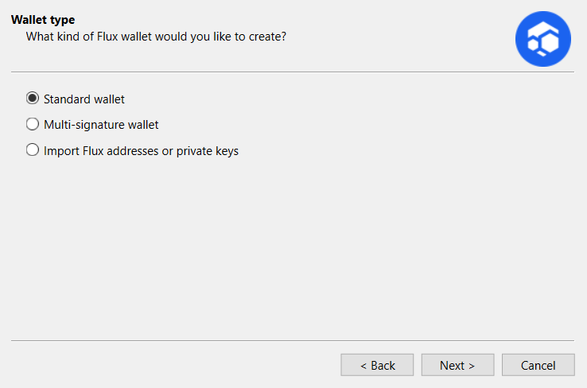
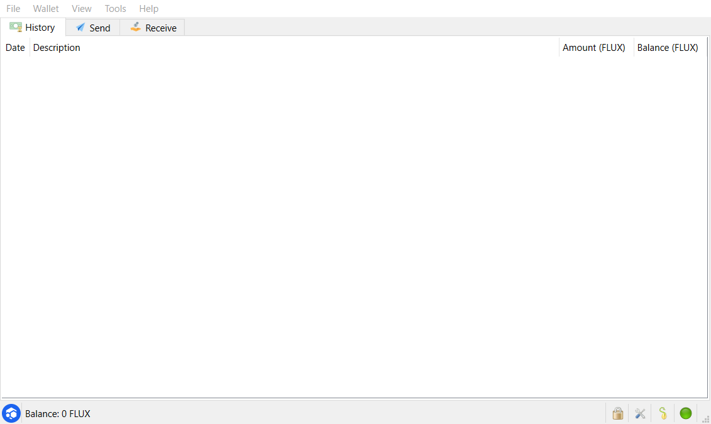
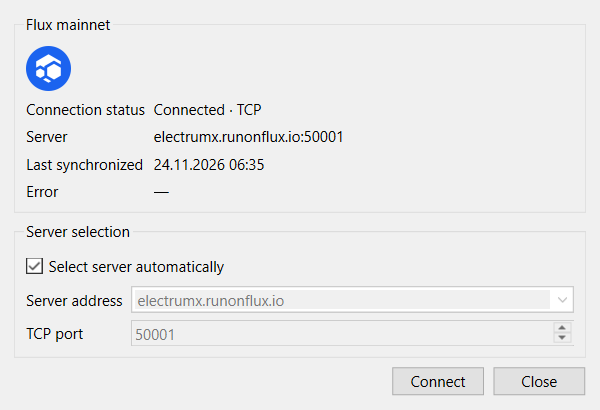

# Electrum-FLUX

AltForge's Windows desktop wallet for transparent payments on Flux mainnet. It uses Electrum wallet storage, PyQt and the Electrum protocol. This is an independent project.

## Windows

Download [Windows x64 portable](https://github.com/AltForger/Electrum-FLUX/releases/download/v0.1.0/Electrum-FLUX-0.1.0-win64-portable.exe) or the [Windows x64 installer](https://github.com/AltForger/Electrum-FLUX/releases/download/v0.1.0/Electrum-FLUX-0.1.0-win64-setup.exe) from the [0.1.0 release](https://github.com/AltForger/Electrum-FLUX/releases/tag/v0.1.0).

Run the portable executable to keep wallets and settings in `Electrum-FLUX-data` beside the program. The installer uses the current Windows account. Its wallet files are under `%LOCALAPPDATA%\Electrum-FLUX\mainnet\wallets`.

The wizard creates or restores a BIP39 wallet with an empty BIP39 passphrase. The account path is `m/44'/19167'/0'`. Use an account xpub for watch-only access, an account xprv for signing, or import transparent addresses or WIF private keys. Passwords encrypt wallet files. Keep a recovery copy of your seed or imported private keys. A multisignature backup also requires the threshold and the other cosigners' account keys. The seed cannot recover independently imported keys.

## Sending and receiving

The Send tab shows the amount, destination and network fee for review before broadcast. Max spends confirmed eligible outputs. The wallet signs native Flux version 4 transactions locally. Multisignature wallets use sorted P2SH scripts and exchange partial signatures using Flux-specific `.fluxtx` files. Use File → Open multisig transaction to review all outputs and sign. Transactions expire after 120 blocks from preparation. The wallet supports transparent payments. FluxNode collateral management, shielded payments and hardware signing are outside this version.

## Network

The Network dialog displays the active peer and supports manually setting the host and TCP port. The defaults are `electrumx.runonflux.io:50001` and `electrumx2.runonflux.io:50001`. The wallet queries address histories over plain TCP. Confirmed transactions are checked against block headers and Merkle roots using the active chain reported by the Flux HTTPS explorer. Synchronization requires both services.

## Source and build

Use Python 3.13 x64, a local `.venv`, the versions in `requirements-win64.lock`, MinGW-w64 GCC and NSIS. Run `build-windows.ps1` in PowerShell. The build runs the unit tests and writes the executables to `dist/0.1.0`. Dependency sources and license notices are included in [DEPENDENCIES.md](DEPENDENCIES.md) and [licenses](licenses).

